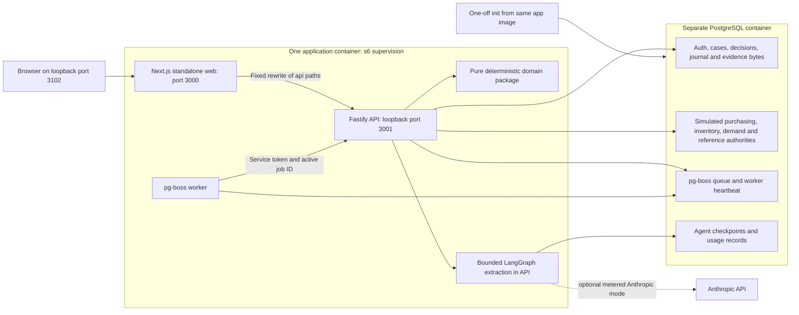
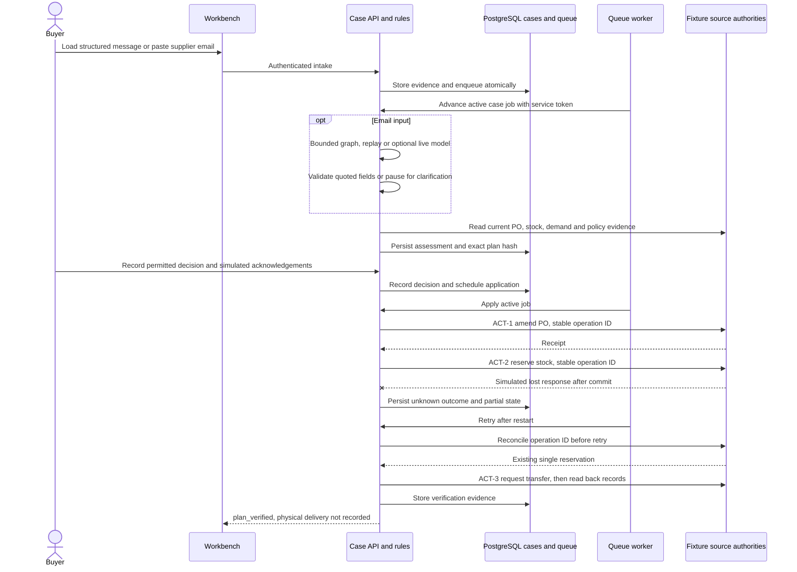

# Supplier disruption architecture

Implementation and documentation baseline: inspected 2026-10-23. Later changes
before this snapshot are limited to the extraction system prompt, the evaluation
runner, its recorded results and the demonstration recording
([ADR 0011](docs/adr/0011-extraction-agent.md)). This describes the recorded
system, not a new runtime verification. The complete demo and container results
for this snapshot are in the verification record; earlier focused checks belong
to earlier development revisions. See
[verification results and limits](docs/verification.md).
The [product contract](SPEC.md) defines intended procurement outcomes.
The [blueprint](docs/blueprint/README.md) is the historical design baseline.
[Development and operations](docs/development.md) contains existing commands.

## Runtime and dependencies

The repository is a pnpm TypeScript monorepo. Pins come from
[package.json](package.json), [the catalog](pnpm-workspace.yaml),
[the lockfile](pnpm-lock.yaml), [Dockerfile](Dockerfile) and [Compose](compose.yaml).
These are installed-build pins, not claims about the latest upstream releases.

| Layer | Resolved project version |
| --- | --- |
| Node / pnpm / TypeScript | 24.22.0 / 12.14.0 / 6.0.3 |
| Next.js / React / Tailwind CSS | 16.4.2 / 19.3.1 / 4.3.3 |
| Fastify / Better Auth | 5.12.7 / 1.7.10 |
| Drizzle ORM / pg / pg-boss | 0.45.4 / 8.23.1 / 12.38.0 |
| LangGraph / PostgreSQL checkpoint saver | 1.4.20 / 1.0.6 |
| Anthropic SDK | 0.131.0 |
| PostgreSQL / s6-overlay | 18.6 / 3.2.3.2 |
| Vitest / Playwright / Prettier | 5.0.5 / 1.64.1 / 3.9.10 |

The image uses digest-pinned Node and PostgreSQL bases and checksum-verified s6
archives. Build stages fetch/install the frozen lockfile, compile packages and
Next standalone, then use `pnpm deploy --prod` for API and worker artifacts.
Only runtime artifacts enter the final image. See
[toolchain decisions](docs/adr/0001-workspace-pilot-toolchain.md) and
[image lifecycle](docs/adr/0002-app-image-lifecycle.md).

## Processes, ingress and trust

One non-root application container contains three supervised processes. PostgreSQL
is a separate long-running container. The `init` Compose profile runs a bounded
migration/seed command from the same application image; it is not another running
application service. No Redis, vector database or object store is required.
Original evidence bytes are in PostgreSQL, not an evidence filesystem volume.

[Next configuration](apps/web/next.config.mjs) uses a fixed `/api/*` rewrite to
`http://127.0.0.1:3001`, with no custom Next server and compression disabled
for streaming. Keep `API_PORT=3001` paired with that target; changing only
the API listener port disconnects the web proxy. Internal `/internal/*` routes
are not rewritten. Compose publishes the web app on `127.0.0.1:3102`.
PostgreSQL has no host port in normal Compose. The development overlay uses
`127.0.0.1:${SD_DB_HOST_PORT:-55102}`. A host-port override also needs matching
host database URLs; it does not change the container's `db:5432` address.

The [API](apps/api/src/app.ts) owns Better Auth sessions, organization membership,
case actor authority, decisions, business writes and provider credentials.
[Internal routes](apps/api/src/routes/internal.ts) reject browser cookies and
require the worker token plus a matching active job. The
[worker](apps/worker/src/main.ts) consumes jobs and calls those API routes; its
DB role has queue/heartbeat access, not business authority. Contrary to the
original blueprint, **model execution also runs inside the API**, reached through
the durable case job. This keeps authority in one place but couples model latency
and failure load to the API process.

The fixture buyer and manager authenticate through real sessions but represent
synthetic actors, not enterprise identity. A selected simulated supplier/planner
role does not authenticate a real supplier or warehouse. Browser modules cannot
import DB/provider packages or secrets. API/migrator/worker grants are separated
in [grants.sql](packages/db/sql/grants.sql); only one-off init receives the migrator
URL and fixture passwords. Processes in one container are not security sandboxes.

## Package and state ownership

| Location | Responsibility |
| --- | --- |
| [apps/web](apps/web/) | Exception queue, case evidence, impact/options, review controls, timeline and agent-run display; case page refreshes separately from the pilot SSE demonstration |
| [apps/api](apps/api/) | HTTP/session boundary, seed, clock, extraction composition, case state and source-effect coordination |
| [apps/worker](apps/worker/) | Queue consumption, internal API delegation, heartbeat, bounded startup/shutdown |
| [packages/contracts](packages/contracts/) | Validated commands, domain values, snapshots, plans, states and agent records |
| [packages/domain](packages/domain/) | Pure intake, UOM conversion, eligibility, calendar, allocation and hashed plan creation |
| [packages/db](packages/db/) | Schema, migrations, grants, canonical seed and distinct fixture source adapters |
| [packages/agent](packages/agent/) | Graph, fixed tools, provider/replay adapters, proposal validation and evaluation helpers |
| [packages/config](packages/config/) | Validated environment/secrets and runtime modes |
| [packages/connector-erpnext](packages/connector-erpnext/) | Standalone local ERPNext sandbox connector proof, isolated from the application workflow |
| [evaluation](evaluation/) | Synthetic development/holdout manifests, live reports, redacted recordings and local spend ledger |
| [infra](infra/) / [scripts](scripts/) | Container supervision, database initialization, demo and test orchestration |

[Case tables](packages/db/src/schema/cases.ts) persist original message deliveries,
cases, immutable assessments/plans, decisions, action journals and ordered events.
Messages retain exact bytes and SHA-256. Plans bind source versions and content
hashes. Current case state and decision/action status are mutable; historical
messages, plans and events remain inspectable. Migration 0004 adds the workflow;
0005 adds agent run/step records and the `agent_checkpoint` schema.

Purchasing owns accepted PO revisions and received/cancelled quantities. Inventory
owns physical stock, reservations and transfer requests. Demand is read-only.
Reference records supply synthetic item mappings, policies, suppliers and actors.
[Source modules](packages/db/src/authorities/) maintain current heads, native-style
operation IDs and receipts inside PostgreSQL transactions. These are separate
simulated source authorities sharing one database. Their local transaction behavior
is not a guarantee about remote ERP APIs.

Quantities are validated strings/rational conversions with integral EA rules;
cost is currency plus integer minor units. Proposed schedule segments replace the
affected supply projection instead of adding supply. Canonical eligible stock is
30 at warehouse A plus 40 timely supplier units: 70 covered, 50 short. A 50-unit
same-SKU transfer from B costs EUR 160. The buyer's EUR 100 approval ceiling is
insufficient. The later 80 supplier units and unrelated reservations remain
separate. Neither a reservation nor a transfer request increases physical stock.

## Business flow and partial recovery

[CaseWorkflow](apps/api/src/cases/workflow.ts) stores intake and schedules
`case-application` work. [Application](apps/api/src/cases/apply.ts) records stable
operation IDs before separately committing ACT-1 PO amendment, ACT-2 reservation
and ACT-3 transfer request. The journal distinguishes success, failure and unknown
outcome. A timed-out committed write is reconciled by operation ID/read-back before
retry. A job completing is not by itself business verification.

Canonical approval and acknowledgement bind the exact plan.
[ADR 0013](docs/adr/0013-current-policy-execution-guards.md) supersedes the earlier
pinned-policy and pre-claim freshness behavior in ADR 0009. Assessment reads
current policy versions; the decision transaction checks current AUTH-1 and returns
409 `stale_policy` before reassessment when the plan is outdated.

Every execution claim locks the case row and the approver's actor row, then checks
approval/expiry, current AUTH-1, bound demand/PO/stock versions and unconfirmed
transfer quotes. Confirmed actions supply the plan's expected successor versions.
A conflict before any effect invalidates decisions and reassesses; after an attempt
it retains known effects and stops later actions in an owned partial/clarification
state. The [guard ADR](docs/adr/0013-current-policy-execution-guards.md) and
[verification record](docs/verification.md) describe the tested races and limits.

Case commands serialize on the case row; actor revocation waits for the claim
commit. Policy and source heads are read in separate committed snapshots without
source locks. A policy or demand change after the guard read can therefore allow
that already claimed write; the next claim refuses. PO and stock writes also
enforce source preconditions. This is not an atomic transaction across remote
authorities. Only AUTH-1 is rechecked per claim; other policy versions are current
at assessment. A shared 10-connection pool without a connection timeout remains
an untested concurrency limit.

[ADR 0016](docs/adr/0016-workflow-interruption-recovery.md) adds stored command
digests, stable operation IDs, attempt keys and cancellation reconciliation.
An uncertain action is read back before any resubmission. Eight unproven
attempts/read-backs leave a visible unresolved outcome for a person. Process
and container kill checks cover selected journal and queue boundaries.
Purchasing has no attempt fence: an already claimed write can land after
revocation, and the same operation can be resubmitted after an unfenced absence
while approval remains current. There is no final-confirmation command for
an unresolved action or workbench control for revocation/compensation.

`plan_verified` means that source records matched the recovery plan, not that
physical receipts or customer delivery occurred.
[ADR 0015](docs/adr/0015-verification-currency-and-revisions.md) makes verification
valid for four hours, retains read-back history and supports rechecks and linked
later revisions. Prior commitments are carried forward without duplicate
coverage. Dispatch/receipt observations change no stock.
[ADR 0014](docs/adr/0014-clarification-correction-resume.md) separates notes,
unsent questions, recorded supplier replies and cited corrections. A supported
correction produces a new assessment and requires decisions bound to its plan.

## Agent graph and human boundaries

The [graph](packages/agent/src/graph.ts) has `agent` and `tools` nodes and ends on a
validated proposal or pause. Its five [registered tools](packages/agent/src/tools.ts)
read case evidence, read a purchase order, inspect demand/stock, propose supplier
terms and escalate. No tool approves, writes an ERP, sends mail, selects a substitute
or invents a UOM conversion. The [validator](packages/agent/src/validate.ts) checks
strict schema plus semantic support from exact email quotes or PO fields read in
that run. Unsupported/low-confidence values pause visibly. Untrusted email text
cannot change tools or authority.

[Email extraction](apps/api/src/cases/extraction.ts) stores canonical email bytes,
deduplicates by digest identity and queues the graph. A supported proposal becomes
an insert-only structured supplier input and passes through the same deterministic
intake/assessment as fixture messages. Human approval and simulated supplier and
warehouse acknowledgements remain independent of extraction. Clarification and
cited corrections follow [ADR 0014](docs/adr/0014-clarification-correction-resume.md).

PostgresSaver checkpoints use the run ID; run/step records retain model/tool counts,
usage, cost, latency, accepted proposals and evidence locators. An unfinished
checkpoint resumes the same run after the API is killed mid-graph, with only the
remaining run cap admitted through the spend ledger, a per-case advisory lock and a
checkpoint contract version that refuses incompatible checkpoints. See
[ADR 0019](docs/adr/0019-checkpoint-recovery.md) and
[recorded verification](docs/verification.md). Recovery and provider failures
were exercised with a local fake provider, not live failure injection.

## Modes, budget and credentials

| Mode | Actual behavior |
| --- | --- |
| Default Compose | Fixture data, synthetic authentication, deterministic rules; no model key or cloud dependency |
| Email with `AGENT_PROVIDER=none` | Stores evidence and pauses `agent_provider_unavailable`; no model invocation |
| Recorded demonstration | `corepack pnpm demo` uses a labelled fixed business clock and exact request-digest replay for the stored C-01 email; a different unsupported email pauses |
| Anthropic | Explicit API provider configuration, key-file access and separately authorized metered use; default configured model `claude-haiku-5-5` |
| Evaluation | Separate runner compares regex baseline, normalized expected terms and live/replay model output over synthetic cases; most rows use an in-memory world |

[.env.example](.env.example) defines API provider settings. It does not automatically
inject them into Compose: the app receives only declared environment and mounts.
The default image deployment has no provider key mount. Live-container
configuration needs explicit environment/secret wiring and recorded verification.
`AGENT_MODE=rules` is the base configuration value even when the separate
`AGENT_PROVIDER` selects email extraction; it is not proof of no provider call.

The default tool budget is 10, ceiling 12 including retries/rejected calls, with a
separate 14-model-call bound. The default per-run cap is USD 0.05 and application
total cap is USD 1 within validated limits. The cumulative project budget is
USD 20 with a mandatory pause at USD 15 across application and evaluation use.
[ADR 0017](docs/adr/0017-project-spend-reservations.md) uses one durable ledger:
admission reserves worst-case run cost under a shared transaction lock, and
unknown usage retains its reservation until evidence-based reconciliation.
A new database refuses metered runs until opened with a reconciled balance.
The concurrent admission race was tested; live billing and some settlement
paths remain unverified. Replays incur no new model spend. Historical metered
cost and current accounting requirements are in [verification.md](docs/verification.md).

## Operations and evidence limits

s6 starts web/API/worker with a shared boot identifier. Aggregate readiness requires
API/schema readiness, the web listener and a fresh worker heartbeat from this boot.
A failing essential service triggers a nonzero container exit and structured
`sd-first-failure` log; Compose restarts it. The image has a read-only root,
dropped capabilities, `no-new-privileges` and bounded writable tmpfs paths.
Shutdown drains with a 60-second Compose grace period.
[ADR 0002](docs/adr/0002-app-image-lifecycle.md) defines the original bounds;
[ADR 0021](docs/adr/0021-restore-and-lifecycle-bounds.md) adds hung-watchdog
detection and measured TERM-to-KILL escalation.

The workbench shows case events, action receipts/read-backs and agent usage. API
logs and queue/heartbeat records diagnose startup/retry failures. The pilot's
bounded SSE verifies proxy flushing and authorization. Before subsequent events,
open streams recheck the session and membership immediately before writing and
close when access is revoked. Last-Event-ID continues the same bounded sequence;
it does not replay stored case events. Sign-in is limited per account plus a
shared ceiling. [ADR 0020](docs/adr/0020-session-stream-security.md) records
refresh-cookie, limit and stream checks. The browser does not call the refresh
route or automatically resume the pilot stream; counters live in one API process.

`corepack pnpm db:backup` and `corepack pnpm db:restore` use one exported
database snapshot and restore only into an empty database of the same major
version. A manifest checks table contents, foreign keys and message hashes.
A restored pending fixture action reconciles by operation ID without a duplicate
write. The healthcheck detects a hung watchdog. See
[ADR 0021](docs/adr/0021-restore-and-lifecycle-bounds.md) and the
[backup and restore runbook](docs/operations/backup-restore.md). The restore test
backs up an idle database; concurrent-write consistency rests on snapshot design.
Logical local backups provide no built-in encryption or point-in-time recovery.

Targeted checks include clarification, revisions, termination, sessions and
restore/lifecycle; their commands and the complete container suite result for
this snapshot are in [verification.md](docs/verification.md).
Untouched synthetic holdout-1 remains 6/10 outcomes and 5/9 exact extraction.
Later rescores and holdout-2 are exposed-set regression evidence. The historical
normalized arm injects expected outcomes, so it is not a full deterministic
workflow comparison. The single live run on the independent external holdout-3
set is recorded in [its report](evaluation/reports/holdout-3-live.md) and the
[evaluation guide](evaluation/README.md).

[ADR 0018](docs/adr/0018-erpnext-sandbox-connector.md) records real HTTP proof
against a disposable local ERPNext/Frappe 16.52.0 sandbox. The connector is
isolated from the API, worker, demo and Compose. Reads, conditional date-only PO
updates, draft transfers, permission refusals and lost-response read-back were
exercised. Quantity changes, schedule splits and cancel/amend remain manual;
plan-bound reservation and transfer submission remain unresolved. The canonical
40/80 split is not implemented by the date-only update. Graph mailbox proof is
absent, and Peppol remains a semantics reference. See [research](docs/research.md).

The system uses synthetic records and simulated actors. Known gaps include
purchasing fences, final unresolved-action confirmation, real provider-failure
proof, client refresh/resume, some log scans, broad capacity and full
keyboard/theme/narrow-screen review. No complete SPEC verification, physical
delivery, customer outcome or production-readiness claim follows from this work.

## Architecture decisions

These records describe decisions at their original revisions. Read supersession
notes and [verification.md](docs/verification.md) for the current evidence scope.
ADR 0013 defines claim freshness, extended by ADRs 0014–0021 in their stated areas.

| ADR | Decision |
| --- | --- |
| [0001](docs/adr/0001-workspace-pilot-toolchain.md) | Toolchain pins, lint compatibility and explicit auth checks |
| [0002](docs/adr/0002-app-image-lifecycle.md) | One non-root application image, supervision and lifecycle bounds |
| [0003](docs/adr/0003-proxy-cookies-and-streams.md) | Same-origin proxy, cookie handling and bounded status streaming |
| [0004](docs/adr/0004-domain-fixture-data.md) | Domain contracts, exact quantity representation and canonical seed |
| [0005](docs/adr/0005-fixture-authority-transactions.md) | Versioned fixture authority transactions and operation receipts |
| [0006](docs/adr/0006-public-reference-reads.md) | Attributable reference reads and scoped transfer options |
| [0007](docs/adr/0007-coverage-allocation-plans.md) | Pure eligibility, allocation and immutable hashed plans |
| [0008](docs/adr/0008-intake-identity-guards.md) | Sender, digest, PO identity and base-revision intake guards |
| [0009](docs/adr/0009-durable-case-workflow.md) | Durable cases, exact-plan decisions, journals and read-back |
| [0010](docs/adr/0010-operator-workbench.md) | Operator queue, case workbench and simulated review roles |
| [0011](docs/adr/0011-extraction-agent.md) | Bounded email extraction, evidence validation and evaluation |
| [0012](docs/adr/0012-demonstration-mode.md) | Fixed-clock recorded demonstration without model spend |
| [0013](docs/adr/0013-current-policy-execution-guards.md) | Current AUTH-1 checks and guarded execution claims |
| [0014](docs/adr/0014-clarification-correction-resume.md) | Unsent questions, recorded replies and cited corrections |
| [0015](docs/adr/0015-verification-currency-and-revisions.md) | Verification expiry, rechecks and linked supplier revisions |
| [0016](docs/adr/0016-workflow-interruption-recovery.md) | Interruption recovery, cancellation and bounded uncertainty |
| [0017](docs/adr/0017-project-spend-reservations.md) | Shared model-spend admission and uncertain usage reservations |
| [0018](docs/adr/0018-erpnext-sandbox-connector.md) | Isolated ERPNext sandbox HTTP proof and unsupported operations |
| [0019](docs/adr/0019-checkpoint-recovery.md) | Contract-bound recovery of unfinished PostgreSQL checkpoints |
| [0020](docs/adr/0020-session-stream-security.md) | Session refresh, per-account limits and open-stream checks |
| [0021](docs/adr/0021-restore-and-lifecycle-bounds.md) | Snapshot backup restore, watchdog recovery and shutdown measurements |
