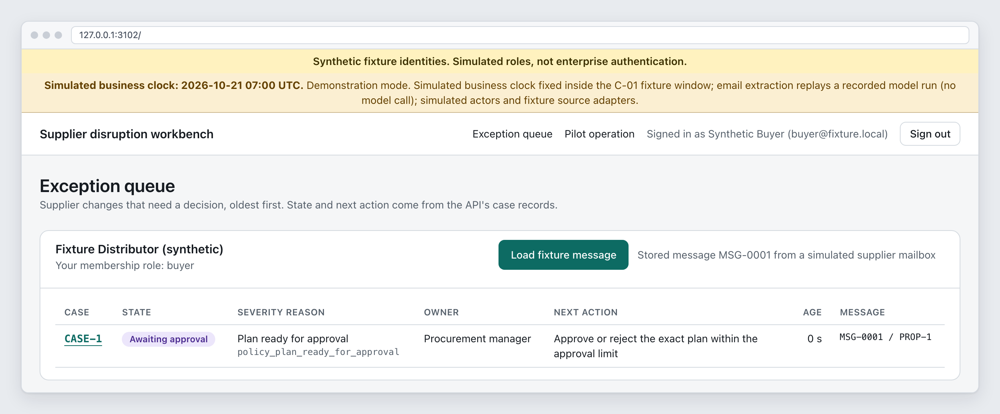
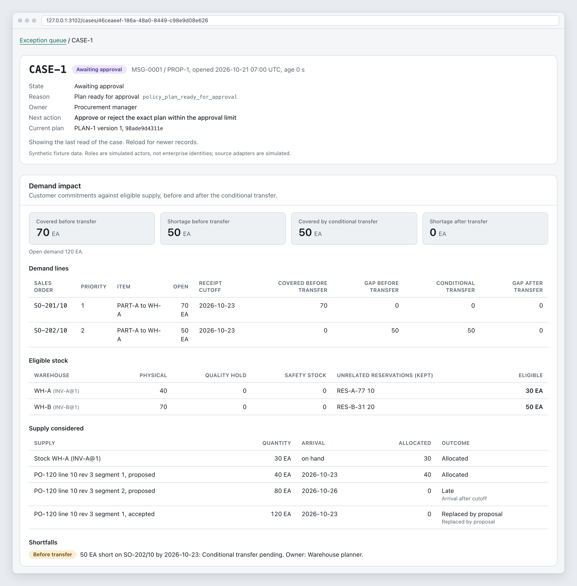
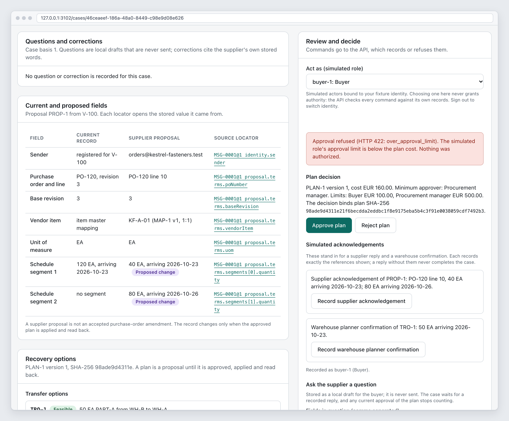
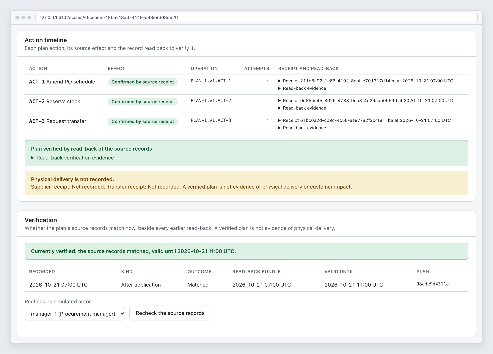
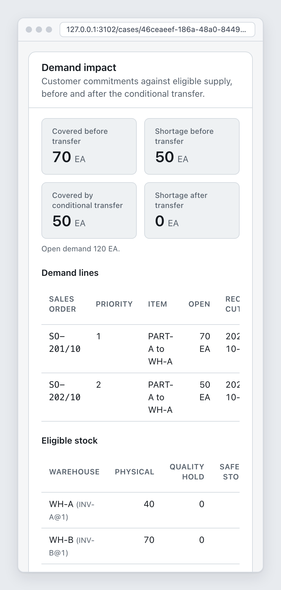
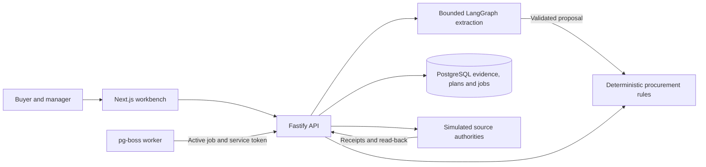

# Supplier disruption resolution

A supplier can deliver 40 units on the promised date and the remaining 80 later.
The buyer needs to know which customer orders are affected, whether another
warehouse can cover the shortage and who must approve the extra cost.

This TypeScript application follows that decision through an evidence-backed
recovery plan. A bounded LangGraph agent extracts cited terms from a supplier
email. Deterministic rules calculate coverage, enforce approval limits and apply
permitted actions. The workbench keeps the message, decisions, uncertain outcomes
and source read-back visible.

The runnable demonstration uses synthetic records and simulated purchasing,
inventory, demand and supplier acknowledgements. `plan_verified` means that the
recovery plan matched the records read back. It does not mean goods arrived.

## Screenshots

These are captures of the packaged application in its no-key demonstration
mode: synthetic records, simulated roles, a fixed simulated business clock and
no model call. They were produced by `corepack pnpm screenshots` at the
final pre-release implementation revision; the [screenshot index](docs/demo/screenshots/README.md) holds the raw
captures, frame recipe and provenance manifest.



_The exception queue. Each case shows its state, owner and next action from the
API's records. The notices state the demonstration mode on every page._



_The deterministic assessment of the canonical case. The supplier's 40 on-time
units and 30 eligible local units cover 70 EA; a 50 EA transfer from WH-B closes
the gap. The 80 late units do not count before the receipt cutoff._



_Every proposed field links to the stored message it came from. The buyer's
approval is refused because the EUR 160 plan exceeds the EUR 100 limit; the
procurement manager must approve it._



_After the manager's approval and the simulated confirmations, every action is
confirmed by read-back. `plan_verified` still records no supplier or transfer
receipt. The [case history](docs/demo/screenshots/05-uncertain-write-history.png)
shows how the ACT-2 reservation response was lost, recorded as unknown and then
reconciled by operation ID without a second reservation._



_At phone width the totals stack and wide tables scroll inside their panel._

## Status and limitations

This is a local prototype. The fixture workflow includes approvals, clarification
questions and recorded replies, cited corrections, verification expiry and rechecks,
linked later revisions, cancellation and bounded recovery. The
[verification record](docs/verification.md) separates historical full-suite results
from later focused checks and lists the remaining gaps.

A separate [ERPNext connector proof](docs/adr/0018-erpnext-sandbox-connector.md)
exercised HTTP reads and conditional writes against a disposable local
ERPNext/Frappe 16.52.0 sandbox. It is not connected to the API, worker or demo.
The canonical quantity split remains manual in that connector; plan-bound
reservation and transfer submission remain unresolved. There is no mailbox
integration or real supplier authentication.

Untouched holdout-1 extraction stayed below the specification's 90% target.
The single run on the independent holdout-3 set met the extraction targets on
16 synthetic cases; see [evaluation results](#evaluation-results) for its
limits. The phone-width capture shows the responsive layout, but keyboard,
theme and accessibility review remain incomplete. There is no
production-readiness, physical-delivery, customer-impact or savings claim.

## Quick start

Prerequisites: Node 24.22.0, Corepack and Docker with Compose v2. The repository
pins pnpm 12.14.0. Run from the repository root:

```sh
corepack pnpm install --frozen-lockfile
corepack pnpm demo
```

Open `http://127.0.0.1:3102`. Sign in as `buyer@fixture.local` or
`manager@fixture.local`. The command prints the local password-file paths and
next steps, without printing passwords. Follow the
[walkthrough](docs/demo/README.md) to load the fixture message, see the buyer's
approval refused above EUR 100, record the matching simulated decisions and
reach `plan_verified`. The recovery plan costs EUR 160; the manager limit is EUR 500.

The demo creates missing local secrets and builds or reuses its image. It starts
the separate `supplier-disruption-demo` Compose project on loopback port 3102,
which must be free. **Starting the demo again replaces that project's previous
data.** It fixes and labels the business clock and replays one recorded email
extraction. It needs no provider key and makes no model call.

To stop it and remove its containers and database volume:

```sh
corepack pnpm demo:down
```

The default development app also uses port 3102. See
[development and operations](docs/development.md) for startup troubleshooting,
seed conflicts and deliberate disposable resets. Avoid broad Docker cleanup.

## How it works

Next.js, a Fastify API and a pg-boss worker run as three supervised processes in
one application image, with PostgreSQL in a separate container. The API owns
sessions, procurement decisions, provider credentials and business writes.
The worker consumes durable jobs and calls authenticated internal API routes.



The agent has five fixed tools: read case evidence, read a purchase order, inspect
demand and stock, propose supplier terms, and escalate. It cannot approve a plan,
write an ERP record or send a message. Schema and evidence checks validate its
proposal before deterministic intake and assessment.

Approval binds the exact plan hash and source versions. Each execution claim
checks current authority, policy and evidence. Actions commit separately, so a
timed-out write stays uncertain until reconciled by operation ID and read-back.
A source change can invalidate the next claim; this is not a transaction across
remote systems. See [architecture](ARCHITECTURE.md) and its 21 decision records.

## Configuration and modes

[.env.example](.env.example) lists supported variables. Secrets belong in local
files. Host `.env` settings reach containers only when Compose explicitly declares
their environment variables or secret mounts.

| Mode              | Behavior                                                                                                                 |
| ----------------- | ------------------------------------------------------------------------------------------------------------------------ |
| Fixture rules     | Structured supplier input, synthetic identities and deterministic procurement rules                                      |
| Recorded demo     | Fixed business clock and request-matched recording for the canonical email; no new model spend                           |
| Provider disabled | `AGENT_PROVIDER=none`, the default; email is stored and pauses `agent_provider_unavailable`                              |
| Live extraction   | Explicit `AGENT_PROVIDER=anthropic` and `ANTHROPIC_API_KEY_FILE`; metered proposals behind the same deterministic checks |

The configured model default is `claude-haiku-5-5`. `AGENT_MODE=rules` alone
does not establish whether a model call will occur; `AGENT_PROVIDER` selects
email extraction. The tool budget defaults to 10 with a ceiling of 12 including
retries and rejected calls. Metered API and evaluation runs share a durable spend
ledger with conservative reservations for unknown usage. Read the
[spend design](docs/adr/0017-project-spend-reservations.md) before paid work.

Normal Compose exposes only the web app on loopback. The development overlay
publishes PostgreSQL on `127.0.0.1:55102`. Keep `API_PORT=3001` paired with the
web rewrite's fixed `http://127.0.0.1:3001` target.

## Evaluation results

The live extraction runs use synthetic cases and Claude Haiku 5.5. Exact
extraction counts the supported, unambiguous cases that expect a proposal, so
its denominator differs from the case count. Each run was made at its own
development revision before this repository's snapshot.

| Run                               | Correct outcomes | Exact extraction | Critical violations | Cost         |
| --------------------------------- | ---------------- | ---------------- | ------------------- | ------------ |
| Development, dev-1                | 23/25            | 16/18            | 0                   | USD 0.015312 |
| Untouched holdout-1               | 6/10             | 5/9              | 0                   | USD 0.008955 |
| Exposed-set regression, holdout-2 | 7/10             | 6/9              | 0                   | USD 0.005246 |
| Independent holdout-3, single run | 16/16            | 10/10            | 0                   | USD 0.0085   |
| Holdout-3 deterministic baseline  | 6/16             | 4/10             | 4                   | none         |

Holdout-1 stayed below the specification's 90% extraction target; an offline
rescore after exposure (8/10, 7/9) does not replace that untouched result. After
a system-prompt change, a separate author wrote the 16-case holdout-3 set and
froze it outside the repository (`MANIFEST.sha256` SHA-256
`e18dc47b20c27f6935f646e7e3a458fac43031ffe352ef087a577c3da6e1a1c3`). It was run
once at a frozen revision, with the model, prompt, tools, validator and scorer fixed
first. The model extracted 84 of 84 required fields exactly, and 43 of 43 fields
in the five proposals intake accepted on PostgreSQL had correct provenance. Its
one downstream disagreement (J13) is shared by the oracle-normalized arm and is
a gap in the seeded world, not an extraction error. Seven cases name orders or a
sender outside that world; for the model, five were checked in memory only (J04
and J12 paused before intake). The agent source has changed
only in comments since that run.

This is one model, one run and synthetic email; the set is now exposed, so later
changes make it regression evidence only. See the
[evaluation guide](evaluation/README.md), the
[holdout-3 report](evaluation/reports/holdout-3-live.md), the
[original reports](evaluation/reports/) and the
[extraction ADR](docs/adr/0011-extraction-agent.md).

The project spend ledger records USD 0.085003 in total for all metered runs,
with nothing reserved or uncertain, reconciled on 2026-10-24 against the local
evaluation record. The provider console was not checked. Zero critical
violations describes the declared extraction runs and is not a general safety
guarantee.

## Verification

This repository's snapshot passed every check on 2026-10-24: install, lint,
format, typecheck, 630 unit tests, build, 508 integration tests,
the full packaged container suite at 66/66 and the no-key demo. The
[verification record](docs/verification.md) lists each command and exit,
earlier focused results recorded during development, the evaluation history and
the remaining limits. Recorded platform evidence is linux/arm64 on Docker
Desktop for macOS.

## Project structure

```text
apps/
  web/                 Next.js queue, case workbench and review controls
  api/                 Sessions, workflow, extraction and source coordination
  worker/              Durable jobs, internal API calls and heartbeat
packages/
  contracts/           Browser-safe schemas and data contracts
  domain/              Pure intake, conversion, eligibility and allocation rules
  db/                  Migrations, grants, evidence and fixture source adapters
  agent/               Graph, tools, providers and evidence validation
  config/              Environment, secret and mode validation
  connector-erpnext/   Isolated sandbox connector proof
infra/                 Application supervision and database initialization
scripts/               Setup, demo, backup and verification commands
evaluation/            Synthetic cases, recordings and original reports
docs/                  Runbooks, architecture decisions and evidence
```

Change presentation in `apps/web`, API authority and workflow in `apps/api`,
pure procurement rules in `packages/domain`, and model tools or validation in
`packages/agent`. Keep connector proof separate until an explicit integration
design establishes the required source guarantees.

## Documentation

- [Documentation index](docs/README.md)
- [Specification](SPEC.md) and [architecture](ARCHITECTURE.md)
- [Demo walkthrough](docs/demo/README.md) and [current screenshots](docs/demo/screenshots/README.md)
- [Development and operations](docs/development.md)
- [Backup and restore](docs/operations/backup-restore.md)
- [Verification results and known limits](docs/verification.md)
- [Research and primary-source register](docs/research.md)
- [Third-party notices](THIRD_PARTY_NOTICES.md)

## Development

After installing dependencies, initialize a fresh checkout in this order.
Preserve an existing `.env` rather than copying over it.

```sh
corepack pnpm secrets:init
cp .env.example .env
corepack pnpm build:packages
corepack pnpm db:up
corepack pnpm db:migrate
corepack pnpm db:seed
```

`secrets:init` creates missing files without overwriting or printing them.
Migrations and a matching canonical seed can be rerun. A conflicting seed fails
instead of replacing existing data. The runbook covers host API/worker commands
and serving the web app from its application image.

```sh
corepack pnpm lint
corepack pnpm format:check
corepack pnpm typecheck
corepack pnpm test
corepack pnpm test:integration
corepack pnpm build
```

Unit tests need no database. Integration tests need the initialized database
and Docker. Packaged browser and lifecycle checks additionally need registry
access and Playwright's Chromium headless shell:

```sh
corepack pnpm exec playwright install chromium-headless-shell
corepack pnpm test:container
```

Container gates use a fresh clone of `HEAD` by default and disposable Compose
projects. Follow the [runbook](docs/development.md) for subsets and scoped cleanup.

## Contributing

Read [CONTRIBUTING.md](CONTRIBUTING.md) for conventions and verification, and
[AGENTS.md](AGENTS.md) before agent-assisted changes. Keep domain expectations
independent of the implementation and preserve historical results.

## Security

Report vulnerabilities privately using [SECURITY.md](SECURITY.md). Keep
credentials, real supplier messages and unredacted logs out of issues and Git.
Only the API reads the provider key from its configured local secret file.

## License

[MIT](LICENSE). Copyright 2026 Subodh Jena.

Third-party dependencies, container images and external services keep their
own licenses. [THIRD_PARTY_NOTICES.md](THIRD_PARTY_NOTICES.md) inventories the
declared licenses and flags the LGPL libvips build inside the application image.
