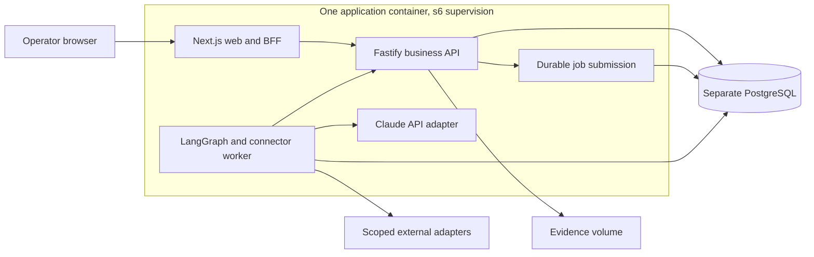

# Application and agent architecture

Blueprint 1.0, 2026-10-18. Proposed implementation contract. Sources and compatibility exceptions are in [VERSIONS.md](VERSIONS.md). Product rules remain in each repository's `SPEC.md`. This is a shared base, not a ceiling: project agents may add appropriate services, libraries and integrations with a short rationale and relevant checks. Routine implementation decisions do not need additional owner approval.

## Deployment and service boundaries

Each repository is a pnpm monorepo with three application services. The owner requested microservices and one app container; consequently these services have explicit interfaces but share a release, host resources and failure boundary. They cannot be scaled or securely isolated independently in this deployment. Splitting containers later requires an ADR and operational tests.



| Service | Owns | Must not own |
| --- | --- | --- |
| `apps/web` | Next App Router, Server Components, interactive review controls, presentation queries, same-origin API proxy | Direct database access, integration secrets, authoritative decisions, long-running jobs |
| `apps/api` | Authentication, case authorization, input validation, domain transitions, evidence access, approvals, command ledger, audit events and job submission | Model-driven approval, arbitrary external destinations, request-lifetime agent runs |
| `apps/worker` | Job leases, LangGraph runs, validated proposals, approved connector execution and reconciliation | User sessions, approval authority, unrestricted domain-table writes, arbitrary model-selected shell or network access |

A separate API adds a network boundary and authentication/proxy work. It is justified here by the requested service architecture and a single authoritative command boundary used by browser interactions, workers and future webhooks. Keep it small. Do not duplicate its rules in Server Actions or add an API gateway, service mesh or Kubernetes to these first deployments.

The only published application port belongs to Next. Use its supported reverse-proxy facilities for `/api/*` and an allowlisted streaming route to the loopback API; use the standard standalone Next server, not a custom server. API binds loopback. Next Server Components call the API with the original session cookie, not a privileged browser-bypass identity. User identity is never trusted from `X-User-*` headers. Browser access to internal worker routes is rejected even if a proxy path is guessed. Verify cookies, original origin, CSRF checks, request limits, SSE flushing and disconnect propagation in the first toolchain pilot. Configuration chooses the upstream, never user input.

## Repository shape

```text
apps/
  web/                     # UI and thin BFF
  api/                     # authoritative HTTP application service
  worker/                  # durable jobs, agent nodes and effect executor
packages/
  contracts/               # versioned Zod schemas, public DTOs and errors
  domain/                  # pure policies, arithmetic and transitions
  db/                      # schemas, migrations and explicitly scoped repositories
  agents/                  # graph, model adapter, prompts and tool definitions
  connectors/              # scoped external and fixture adapters
  ui/                      # owned components and design tokens
  config/                  # typed runtime config and lint/compiler configuration
  observability/           # redaction, events and tracing
fixtures/                  # source-labelled inputs only
evals/                     # isolated oracle, holdout manifest and reports
docs/                      # architecture evidence, setup and runbooks
```

This is a boundary map, not a demand to create empty packages. Start with used packages only. Each package declares exports and `workspace:*` dependencies. Domain and contracts do not import React, Next, a model SDK or a database client. Web cannot import server persistence/provider modules. Enforce import rules in linting. Use pnpm workspace scripts initially; add a task orchestrator only when measured build needs justify it.

Pin `packageManager`, Node engines, dependency versions and one lockfile. Share versions through a workspace catalog. Use strict TypeScript, ESM for Node services and package-appropriate compiler resolution. Build API and worker artifacts explicitly. Next's standalone tracing must include required workspace files. No cross-repository symlinks or imports.

## Identity and authorization

Use Better Auth at the API boundary, backed by PostgreSQL. The web app consumes its session through same-origin endpoints. Set an explicit public `baseURL`, `/api/auth` base path and exact trusted origins. Seeded lab users and role-switching shortcuts are fixture-mode capabilities with a permanent visible label. A publicly exposed or live-data deployment must reject fixture authentication; `NODE_ENV=production` alone also applies to local fixture builds and is not that deployment distinction. Public registration is disabled initially; account provisioning is an operator procedure. Document a later identity-provider integration only after it is tested.

Every API command, query, stream and evidence download authenticates the actor and authorizes organization, case and action. Authorization is server-side, including on reads. Establish scope before retrieval so forbidden documents never enter model context. Organization keys are recorded even in a one-organization lab; this is not a claim of audited multi-tenant isolation. Test cross-case and cross-organization denial.

Use secure HttpOnly cookies in HTTPS deployments, exact trusted origins, CSRF protection for mutations, bounded sessions and explicit role assignments. Domain mutations need their own CSRF/origin checks, beyond Better Auth's auth-route protections. Do not use permissive CORS or derive trusted origins from an arbitrary forwarded Host. Loopback HTTP is a documented local exception. Recheck role membership and active sessions when approving and executing, bypassing session cookie-cache shortcuts for sensitive operations. Do not let a model supply an approver ID.

The worker uses a separate server-only service credential for internal endpoints. The API derives scope from an existing job/run/command record and verifies the credential's permitted operation; a submitted case ID or actor ID is insufficient. Job payloads contain references, not credentials or approval grants. The model has no access to this transport credential. Rotate and audit it. This is a controlled service boundary within one trusted container, not isolation from a compromised worker process.

## Persistence and ownership

Use PostgreSQL in both fixture and live modes so restart and transaction semantics stay comparable. Drizzle owns reviewed SQL migrations for domain/auth data. Separate schemas or clearly prefixed tables hold business data, auth, audit, jobs and graph checkpoints. Library-managed schemas have their own migration procedures. One migration/init step runs before traffic with a database lock; normal service startup checks versions and does not race destructive migrations.

Use separate database roles: migration owner; API application role; worker role limited to queue/checkpoint data and its heartbeat. The worker reads and changes business records through the API. Do not give every process a superuser URL. Queue producers and consumers receive only their library's required grants, verified against the pinned pg-boss migration. Initialize schemas and queues under the migrator; runtime pg-boss uses `migrate: false` and fails clearly if its schema is incompatible. Grant runtime schema changes only if a library demonstrably requires them, with the exception recorded.

Authoritative state includes cases, versioned observations, evidence locators, source revisions, assessments, proposals, approvals, actions and verification results. Audit records append actor, time, prior/new revisions, policy version and reason; application-level append-only rules do not constitute cryptographic tamper-proof storage. Monetary arithmetic uses integer minor units; temporal and quantity semantics follow the domain spec. Preserve original observation timestamps.

Store document bytes in a persistent evidence volume for the initial single-host deployment, with content hash, media type, provenance and authorization metadata in PostgreSQL. API owns ingest and reads. Apply size/type limits, sanitized filenames, extraction time limits and no arbitrary URL fetch. Restrict the initial healthcare repository to known synthetic fixtures. Workers request authorized bounded extracts through the API. Backup the database and referenced blobs consistently. An S3-compatible adapter is a later option when hosting requires it; no extra object-store container is mandatory locally.

## Commands, concurrency and uncertain outcomes

Commands carry contract version, operation ID, expected case revision and relevant source-version vector. The API validates them, applies deterministic policy, and commits state plus durable enqueue atomically. Use the pinned pg-boss transaction integration with the same PostgreSQL transaction; a separate connection or fire-and-forget enqueue is not atomic. Prove this by rollback testing. If the adapter cannot participate, use a domain outbox plus an idempotent relay and record that choice.

Approval binds approver, exact proposal payload hash, case/source/policy revisions, permitted action and expiry. The API validates current approval, policy, actor authority and case/source revisions in the same transaction or compare-and-swap that grants the fenced execution claim, serialized against cancellation. A separate check followed by an unguarded claim is insufficient. A stale command becomes `needs_reassessment`; it does not silently obtain a replacement approval. Revocation cancels an unclaimed command. If an external call is already in flight, record cancellation as pending/uncertain, reconcile the native outcome, and require an explicit compensating decision. Never claim a completed external effect was rolled back by changing a local flag.

The deterministic effect executor, separate from model tools, requests a fenced execution lease for an approved command. It uses the stored immutable payload. A unique operation key plus payload hash rejects changed-payload reuse. Renew or relinquish leases with a bounded timeout; stale workers cannot overwrite a newer result. Native idempotency keys, revision checks or compare-and-swap are required where available. A local transaction cannot make a remote inventory or ledger mutation atomic. If a connector cannot enforce the required precondition or prove uniqueness, keep that action manual or explicitly unresolved.

Persist attempt intent before a call. After timeout or lost response, record `outcome_unknown`, then read native state by operation ID or verified business identity before any retry. The API commits the completion receipt and resulting domain transition together; queue acknowledgement follows. Redelivery after that gap returns the recorded result. `attempted`, `accepted_by_remote` and `verified` are distinct. No end-to-end exactly-once claim follows from pg-boss delivery semantics. Domain-specific closure requires current native readback, and later contradictory observations may reopen a case.

## Agent workflow

The common graph is: load authorized context, identify missing evidence, select bounded read tools, validate source-linked proposals, evaluate deterministic policy, pause for review, resume after a valid server decision, then observe execution/reconciliation. Business-policy nodes and effect execution remain deterministic. Do not build an open-ended swarm. The graph is a recoverable investigation, not the source of truth for a business decision.

Use LangGraph JS with a Postgres checkpointer. Store graph/prompt/schema/model versions and case revision. A checkpoint thread ID is an internal identifier, not an authorization credential. A job rehydrates the known run; a graph waiting for a person must release its worker job instead of occupying a lease indefinitely. The API records the review event and durably enqueues a resume job. Serialize concurrent resumes for the same run and recheck its revision.

LangGraph interrupt nodes rerun on resume. Keep effectful operations outside pre-interrupt code; make node-local writes idempotent. Use synchronous checkpoint durability at important pause/resume boundaries, while relying on domain transactions for business integrity. Define restart and checkpoint-migration behavior per graph version. Do not resume old persisted states with a silently incompatible graph.

The model may select only registered read/propose tools with input schemas, case scope, timeouts and result-size limits. Source documents are untrusted data and cannot redefine tools, permissions or prompts. Extracted facts carry evidence IDs, hashes and locators; deterministic validators check their existence and authorized scope. Citation existence alone is not semantic support, so evaluation must also score whether the cited text supports the claim. Unsupported or conflicting facts remain unresolved.

Use Sonnet 5.5 as the initial investigation model through `@langchain/anthropic`, selecting provider-native JSON output explicitly. Validate the request shape against the pinned adapter. Sonnet/Opus 5.5 reject forced `tool_choice: any` or a named forced tool. Use automatic permitted tool selection and JSON-schema final output, not forced-tool output recipes. Do not carry forward unsupported `temperature: 0` or other sampling overrides. Refusals, truncation, invalid schemas and quota failures are first-class outcomes.

Native JSON output cannot contain Anthropic native citation blocks. Our evidence-reference schema is separate and verified by the application. If the adapter does not implement the documented request shape, use the official Anthropic client inside the same graph node with a recorded dependency decision. Do not silently weaken validation to make a library pass.

Haiku is a candidate for measured classification/extraction; Opus escalation must be explicit, bounded and justified by evaluation. Record the exact model, settings, usage, price snapshot and resulting cost. Access checks use the Models API after credentials are configured by the owner. Public availability does not establish access in that organization. API credits are used through the direct Anthropic account, not an unrelated cloud provider's billing.

Claude Agent SDK is not the default business workflow engine. A future vulnerability patch-generation task might justify it in a separately scoped and reviewed sandboxed repository worker under the task's existing authority. Do not give the current business worker a shell, a Docker socket or unrestricted filesystem tools to demonstrate agentic behavior. MCP is optional for a verified connector, not a universal security or reliability layer.

## Modes, budgets and observability

Keep dimensions separate: `DATA_MODE=fixture|sandbox|live`, `AGENT_MODE=rules|claude`, and `AUTH_MODE=fixture|session`. A real Claude call over synthetic cases is valid but must display both facts. The initial fixture/rules mode requires no external credentials. Missing keys never silently convert a requested model run into a successful scripted one. Real data and real mutations remain outside these initial specs.

Run budgets bound tool calls, tokens, elapsed time, model attempts and cost. A tool retry consumes budget. Reserve a conservative maximum request cost before each call and reconcile actual usage; abort when another call would exceed the authorized bound. Parallel workers share a durable budget ledger so per-process limits do not multiply spending. Admission reserves respect per-application organization/day caps. These five independent databases do not enforce a shared five-app spending ceiling; shared Claude organization limits belong in the provider account unless a budget coordinator is deliberately added. The domain spec may set a stricter call limit. Disable hidden SDK/provider automatic retries by default. Every actual provider attempt, including a retry, must reserve cost and consume call limits through this ledger. If a timeout leaves billed usage unknown, retain the conservative reservation until reconciled; do not free it merely because no response arrived. No model calls are part of this documentation phase.

Use structured logs and OpenTelemetry spans carrying request, case, run, operation, build and trace IDs. Do not log credentials, document bodies or private reasoning. Store restricted audit/evaluation artifacts separately with explicit retention. Trace export and LangSmith are optional, off by default, and require a deliberate data-egress decision.

Persist sanitized progress events with monotonic event IDs. SSE can replay after a last-seen ID and then stream new events. Authenticate every stream/replay and periodically revalidate the active session and current case/organization membership, closing on expiry, revocation or lost scope; never embed bearer tokens in a URL. Report observed steps and outcomes, not internal reasoning. On disconnect, background jobs continue; reconnect reads authoritative state. Queue wait, model time, connector time, errors and cost are separately measurable.

## Compatibility and change control

The [version register](VERSIONS.md) is a dated selection, not a lockfile or a tested integration claim. At the first authorized coding task, perform a small dependency/container pilot, record actual resolved versions, fix only documented compatibility issues, then implement the first domain slice. Do not spend the owner's Claude credits during a toolchain check.

Each repository keeps its own copy of this blueprint and records the adopted version. Changes to business authority, model privileges, deployment boundaries, evidence semantics or evaluation claims require explicit specification/ADR review. Routine patch upgrades still run the applicable regression and persisted-state compatibility gates. A new framework release alone is not a reason to rewrite five applications.
