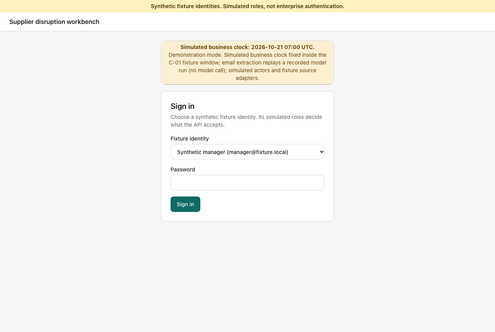
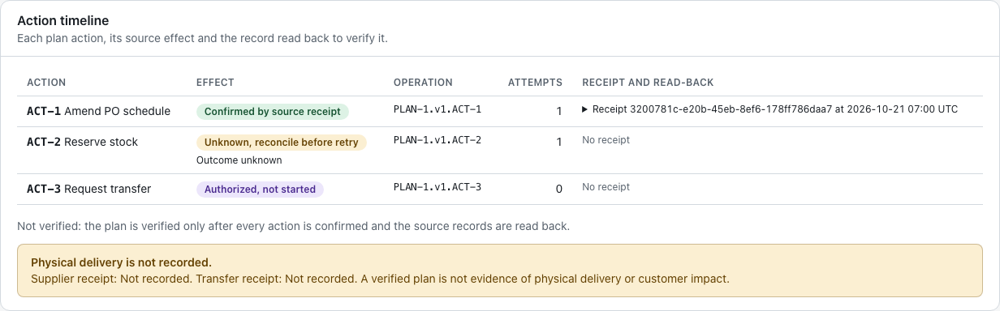
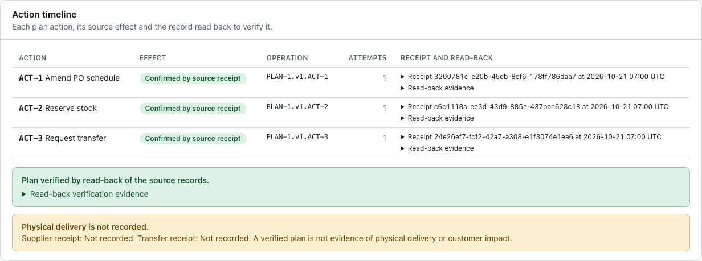
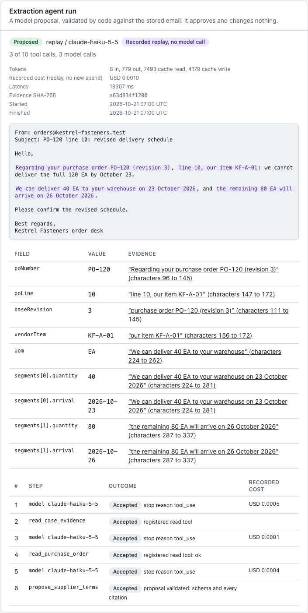
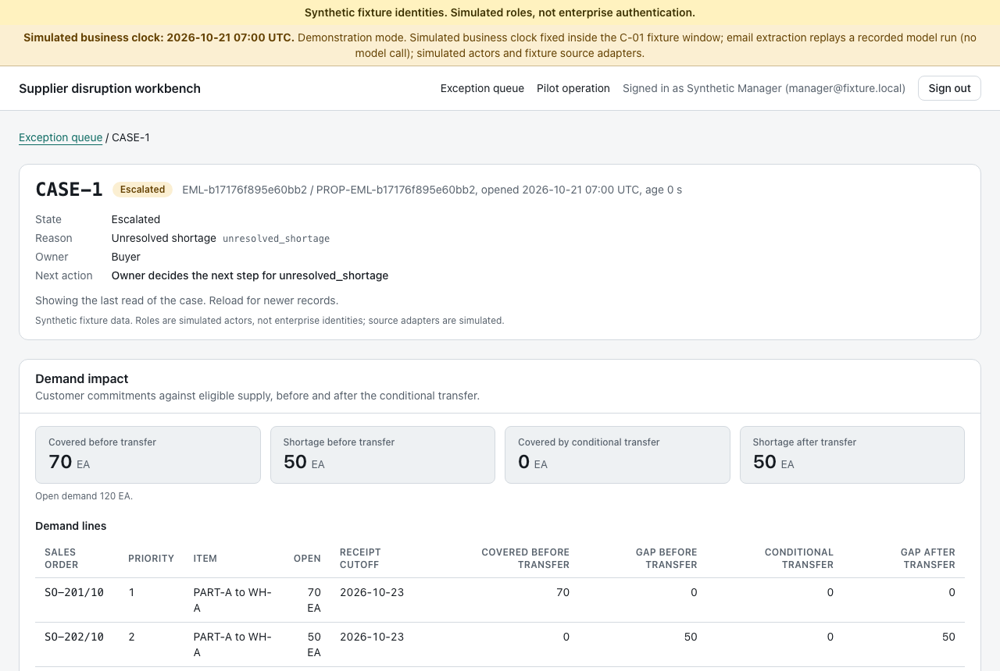
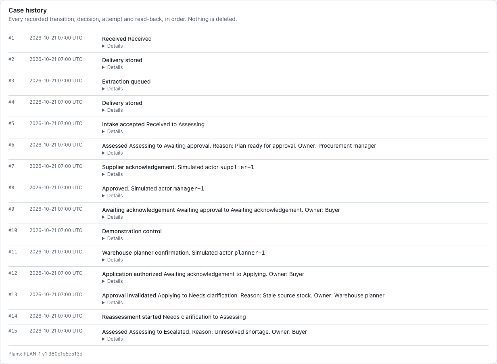

# Supplier disruption demonstration

This walkthrough shows the supplier-disruption use case of an agentic workflow:
a supplier's proposed schedule change for PO-120 becomes an evidence-backed,
approved and verified recovery plan, and the same workflow refuses a plan whose
approval has gone stale. Everything runs locally on synthetic fixtures. The
design of the demonstration mode is in
[ADR 0012](../adr/0012-demonstration-mode.md).

The images embedded below are historical captures from an earlier development revision. Current
framed captures of part 1, with their raw pixels, frame recipe and manifest,
are in [screenshots](screenshots/README.md) and are regenerated with
`corepack pnpm screenshots`.

## Run it

Prerequisites: Docker with Compose v2, Node 24.22.0 and Corepack, from the
repository root after `corepack pnpm install --frozen-lockfile`.

```sh
corepack pnpm demo        # fresh demonstration stack on http://127.0.0.1:3102
corepack pnpm demo:down   # remove its containers, network and database volume
```

`corepack pnpm demo` creates the secrets once if they are missing, removes any
earlier demonstration data, builds or reuses the image
`supplier-disruption-app:demo`, initializes the database with the synthetic
C-01 fixture and starts the application in the separate Compose project
`supplier-disruption-demo`. It then checks that the application reports the
demonstration mode and prints the sign-in identities and next steps. Port 3102
must be free: stop the documented stack first with `docker compose stop app`
if it is running. The demonstration never touches the `supplier-disruption`
project or its volume.

Sign in as `buyer@fixture.local` or `manager@fixture.local`. Their passwords
stay in `.secrets/fixture_buyer_password` and
`.secrets/fixture_manager_password`; the command prints only the paths.

The C-01 fixture is time-bound: an approval expires at 18:00 Copenhagen time
on the day it is given and the TRO-1 transfer quote is valid until
2026-10-22T10:00Z. The demonstration mode therefore fixes the business clock
at the fixture's start, 2026-10-21 07:00 UTC, and says so on every page.



## Part 1: a verified recovery plan through an uncertain write

Run `corepack pnpm demo`, then:

1. **Buyer opens the case.** Sign in as the buyer and choose "Load fixture
   message". CASE-1 opens in `awaiting_approval`: 70 EA covered before the
   transfer, 50 EA short, a feasible 50 EA transfer TRO-1 from WH-B and a plan
   cost of EUR 160. Every extracted field links to its value in the stored
   supplier message. This proves the deterministic assessment of the SPEC's
   canonical case (SD-07) and field provenance (SD-02).
2. **Arm the uncertain write.** In "Demonstration controls (simulated)", choose
   "Lose the response of this case's next reservation write". The control is
   recorded on the case history; it changes no decision.
3. **Buyer tries to approve.** "Approve plan" is refused with HTTP 422
   `over_approval_limit`: the buyer's EUR 100 limit is below the EUR 160 plan
   (SD-08). Nothing is authorized.
4. **Supplier acknowledgement.** Act as `supplier-1` (simulated) and record the
   supplier acknowledgement of exactly the proposed schedule. Sign out.
5. **Manager approval and planner confirmation.** Sign in as the manager, open
   CASE-1, approve the plan (within the EUR 500 limit), then act as
   `planner-1` and record the warehouse planner's confirmation of TRO-1.
6. **Application with a lost response.** The worker applies the plan. ACT-1
   amends the PO schedule. The source commits the ACT-2 reservation, but its
   response is lost: the timeline shows ACT-2 as "Unknown, reconcile before
   retry" and the case as `partially_applied` with `outcome_unknown`, owned by
   the warehouse planner.

   

7. **Reconciliation and verification.** The next run looks the reservation up
   by its operation ID, confirms it from the read-back without resubmitting it
   (ACT-2 keeps one attempt and the source holds one reservation), applies
   ACT-3 and reads every record back. The case reaches `plan_verified`. The
   page still states that no supplier or transfer receipt is recorded: a
   verified plan is not physical delivery (SD-11, SD-12, SD-17).

   

## Part 2: the replayed email and a stale approval

Run `corepack pnpm demo` again for fresh data (part 1 changed PO-120 and the
WH-B stock), then:

1. **Supplier email through the agent.** Sign in as the buyer, choose "Load
   C-01 sample email" and "Submit for extraction". The extraction agent runs
   the bounded LangGraph investigation against the recorded C-01 model run,
   matched by request digest: the panel says "Recorded replay, no model call"
   and labels the cost as the recorded run's, not new spend. Each proposed
   field cites a verbatim span of the stored email or the PO record, and
   deterministic intake and assessment produce the same plan as part 1. Any
   other email text pauses for the buyer as a provider failure, because the
   recording has no response for it.

   

2. **Approvals.** Act as `supplier-1` and record the supplier acknowledgement,
   sign out, sign in as the manager and approve the plan.
3. **A source changes after approval.** Choose "Simulate another order
   reserving 20 EA at WH-B". The fixture inventory authority records that
   reservation for demand outside any case plan; WH-B moves to a new stock
   version and its eligible stock falls from 50 to 30 EA.
4. **Application refuses the stale approval.** Act as `planner-1` and record
   the planner's confirmation. Before claiming any action, application finds
   that the approved plan was bound to the earlier WH-B stock version: the
   approval is marked stale (`stale_source_stock`), every action fails with no
   source write, and the case is reassessed under the current records. The
   TRO-1 quote was bound to the old stock version, so no transfer is feasible
   and the case ends `escalated` with `unresolved_shortage`: 50 EA short on
   SO-202/10, owned by the buyer, who decides the next step (SD-09, SD-14).

   

   

Finish with `corepack pnpm demo:down`.

## What the automated checks prove

- W2 and W3 (`scripts/container/demonstration.test.mjs`, in
  `corepack pnpm test:container`) drive parts 2 and 1 in Chromium against the
  packaged image in its production configuration plus
  `DOMAIN_CLOCK_MODE=demonstration`, each on a disposable project with every
  other origin blocked. They assert the logged mode, the unmoved clock, the
  replayed run, the stale approval, the escalation reason and owner, no plan
  write in a source for W2, and exactly one reservation and one attempt per
  action for W3.
- W1 drives the success path on the controlled test clock; the integration
  suite covers the same workflow paths without a browser.

## Evaluation summary

The extraction agent was evaluated with `claude-haiku-5-5` on original
fictional scenarios; full reports are in
[evaluation/reports](../../evaluation/reports). Spend is the metered cost of
the recorded live runs; the demonstration replays them and spends nothing.

| Run                                        | Baseline outcome correct | Model outcome correct | Model exact extraction | Critical violations (model) | Spend      |
| ------------------------------------------ | ------------------------ | --------------------- | ---------------------- | --------------------------- | ---------- |
| dev-1, 25 development cases                | 13 / 25                  | 23 / 25               | 16 / 18                | 0                           | USD 0.0153 |
| holdout-1, 10 untouched held-out cases     | 1 / 10                   | 6 / 10                | 5 / 9                  | 0                           | USD 0.0090 |
| holdout-2-regression, same set after a fix | 1 / 10                   | 7 / 10                | 6 / 9                  | 0                           | USD 0.0052 |

The baseline is a deterministic pattern extractor. The remaining model
failures are conservative pauses where a proposal was expected. These are
prototype measurements on fictional fixtures with one model, not production
accuracy. ADR 0011 records the review rescore and its limits.

## Limits

- Simulated actors and fixture source adapters. Role switching is a labelled
  simulation, not enterprise authentication, and the purchasing, inventory and
  demand authorities are local fixtures.
- No real ERP, warehouse or mailbox connector. The SPEC's connector proof (a
  pinned ERP and a test mailbox) remains outstanding, so the milestone is not
  complete on this demonstration alone.
- The business clock is simulated and fixed; nothing in the demonstration
  measures elapsed time, expiry or buyer productivity.
- The agent path replays one recorded run of one synthetic email. The
  evaluation was recorded only on synthetic cases with one model.
- The two demonstration controls are stand-ins for events a live session
  cannot wait for. The uncertain-write arming lives in the API process only.
- No customer, delivery, savings or production outcome is claimed. A verified
  plan is not evidence of physical delivery or customer impact.
